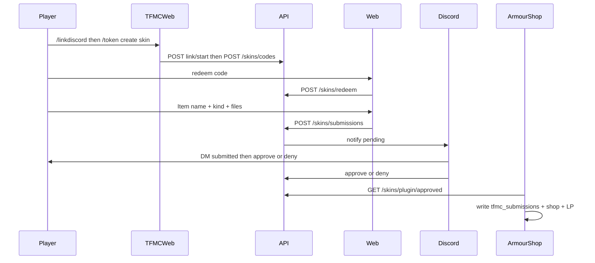

# Skins system

End-to-end design for donator texture submissions on **TFMCWeb** (store + review state).

**See also:** [integrations/armourshop.md](../integrations/armourshop.md) (MC apply), [integrations/discord-bot.md](../integrations/discord-bot.md) (staff UI), [naming.md](naming.md), [flows/journeys.md](../flows/journeys.md).

## Goals

- Donators submit **armor sets** (2D, optional per-tier 3D helmet), **weapon/tool skins** (`handheld` / `large_handheld` / `bow` / `large_bow` / `crossbow`), **3D kinds** (`item_3d` / `shield` / `helmet_3d` / `mask` / `bow_3d` / `crossbow_3d`), **guns** (`gun`), and **books** (`book`; unsigned + signed covers).
- Players start a skin from the Profile wardrobe ([below](#profile-wardrobe)) or with a TFMCWeb code (`/token create skin` or **`/token create skin staff`**); either is bound to the player UUID.
- **Player:** staff approve/deny in Discord; ArmourShop writes **`tfmc_submissions`** + `ps_*` + LP.
- **Staff curated:** auto-approve (no bot); category + scroll on upload; writes **`tfmc_armorshop`** into real ArmourShop categories.
- **Kit item customise** (character creator) also creates `skin_submissions` rows via an internal `lore_upload` code per player — not a donator mint token. Staff review and ArmourShop apply use the same pipeline as Profile skin uploads.

## Upload kinds

| Kind | Multipart fields | Exact sizes | Notes |
|------|------------------|-------------|-------|
| `armor_set` | Per tier: flat helmet **or** 3D model+texture; always chest/legs/boots/layers | Icons **16×16**; layers **64×32** | One SkinSet **per tier** |
| `handheld` | `texture` | **16×16** | Sword-style handheld parent |
| `large_handheld` | `texture` | **32×32** | Grip preset `bottom` / `middle` / `top` |
| `bow` | `texture`, `pull_0`, `pull_1`, `pull_2` | **16×16** | |
| `large_bow` | same four fields | **32×32** | |
| `crossbow` | bow four + `charged` | **16×16** | |
| `bow_3d` | `texture` + `model`, `pull_0_model`, `pull_1_model`, `pull_2_model` | All files together ≤ **61440 bytes**, every rank | `shortbows` / `longbows`; `BOW` + `model_path` |
| `crossbow_3d` | `bow_3d` fields + `charged_model` | Same fixed total | `crossbows`; `CROSSBOW` + `model_path` |
| `item` | - | - | **Disabled** for upload |
| `item_3d` | `texture` + `model` | Pair byte budget from entitlements | `generate: false` |
| `shield` | `texture` + `model` | Same pair budget | Blocking clone at apply |
| `helmet_3d` | `texture` + `model` | Same pair budget | `set: helmets` |
| `mask` | `texture` + `model` | Same pair budget | `set: masks`. Wearing the skinned mask hides identity in RPCharacters |
| `gun` | `texture` + carry/reload/aim models | Three pair checks | GaG `skins.yml` `ia.…` |
| `book` | `unsigned` + `signed` | Both **16×16** | `base_set: books` |

Which item types each kind may target (`base_set`) lives in [`shared/skins/base_sets.json`](../../../shared/skins/base_sets.json), read by both the API and the upload page.

### Animated textures (`.mcmeta`)

Any PNG field may send an optional `{field}_mcmeta` (Minecraft `.png.mcmeta` JSON, ≤ 2048 bytes), except armour layers (`{tier}_layer_1` / `{tier}_layer_2`). Only an `animation` section is accepted (`frametime`, `interpolate`, `width`, `height`, `frames`). With an `.mcmeta`, a fixed-size slot takes a whole grid of frames of that size (e.g. a 16×64 handheld strip of four frames). The API stores it beside the PNG as `{png name}.mcmeta`, lists it for the plugin, and ArmourShop copies it into the pack. Review sheets and 3D preview tiles show the first frame and label the tile `animated · N frames`. For 3D kinds the `.mcmeta` counts toward the byte budget.

Upload **filenames are ignored** for identity - the API validates PNG/JSON and writes fixed stems from the submission id. See [naming.md](naming.md).

### Grip presets (`large_handheld` only)

| `grip_preset` | Meaning |
|---------------|---------|
| `bottom` | Hold near bottom of art (hammer/staff-like) |
| `middle` | Hold mid-art |
| `top` | Hold toward top (longsword-like) |

## High-level flow



## Code rules

| Rule | Behavior |
|------|----------|
| Bound to UUID | Issued with `player_uuid`; cosmetic always granted to that UUID |
| Storage | Hash of code (SHA-256); plaintext shown once in-game |
| Lifetime | Code row expiry; **session 8h** after redeem |
| Consumption | Code marked used **on successful submit**, not on redeem |
| Mint cooldown | Shared with drink. TFMCWeb applies it to `/token create`; TFMCWeb applies the same rule to Profile starts |
| Allowed kinds | Per-rank additive `skin-kinds` whitelist |

**Command gate:** TFMCWeb LP `tfmcweb.token.create`. **Staff (`skin_staff`):** bypasses mint cooldown and upload gates.

Upload requires a prior **Discord link** for that UUID ([identity/tfmcweb.md](../identity/tfmcweb.md)).

## Skin-upload entitlements (TFMCWeb)

Configured in TFMCWeb `config.yml` `player-meta.skins`; pushed on join/reload via `PUT /characters/plugin/rpc-player-meta` and stored in `web_entitlements`.

| Rank | Cooldown | Kinds (additive inherit) | Armor 3D helmet |
|------|----------|--------------------------|-----------------|
| defaults / no rank | disallowed | none | false |
| Noble | 28 days | handheld, large_handheld, bow, large_bow, crossbow, book | false |
| Gilded | 21 days | + armor_set | false |
| Ascended | 14 days | + item_3d, shield, helmet_3d, mask, gun, bow_3d, crossbow_3d | true |
| Legacy | 7 days | (same as Ascended) | true |

## Discord link (MC ↔ Discord)

**Owner: TFMCWeb.**

| Step | Who | What |
|------|-----|------|
| 1 | Player in game | `/linkdiscord` → `POST /skins/discord/link/start` |
| 2 | Player in Discord | `/linkdiscord <code>` → bot `POST /skins/discord/link/complete` |
| 3 | API | Stores `discord_links` row |

Player DMs: submitted (outbox poll); approved / denied from cog after staff API call.

## Storage

### PostgreSQL

Site records share `DATABASE_URL`; see [database configuration and migrations](../ops/postgresql.md).

- `login_codes` - hashed codes, player UUID, scope, expiry, redeemed_at on submit, `minted_via`
- `code_sessions` - the sessions redeemed codes open; the hourly housekeeping sweep deletes expired ones
- `skin_submissions` - kind, display_name, status, paths, discord_user_id, tiers, base_set, grip_preset, name colours/styles
- `discord_links` / `discord_link_codes` - identity bind

### Disk

```text
backend/src/data/skins/{submission_id}/
  meta.json
  …fixed stems per kind…
```

## Validation (summary)

- Id from IGN + item name per [naming.md](naming.md)
- PNG magic bytes; max bytes; **exact** pixel sizes
- `base_set` required for non-armor kinds; `tiers` for armor
- 3D kinds: vanilla Java Block/Item JSON (`elements` + single-axis rotation in 22.5° steps; past ±45° is baked into the cube as quarter turns for 1.21.10 clients); display autofill; pair byte caps
- Requires Discord link stamp at submit

## Review preview

| Phase | What the API serves | Who consumes |
|-------|---------------------|--------------|
| Contact sheet | Composite `review-sheet` PNG (2D textures + 3D tiles when renderer is available) | Discord `#bot-feed` |
| Render failure | `preview_render_error.txt` on disk; staff `X-Sheet-Render-Error` header; Discord **3D preview** embed field | Staff only (texture-only sheet still attached) |

Deploy and verify the headless renderer: [ops/sheet-render.md](../ops/sheet-render.md).

## HTTP contracts

### TFMCWeb → API (`X-Plugin-Key`)

| Method | Purpose |
|--------|---------|
| `POST /skins/discord/link/start` | Issue link code |
| `POST /skins/codes` | Mint skin code |

### ArmourShop → API (via TFMCWeb gateway)

| Method | Purpose |
|--------|---------|
| `GET /skins/plugin/approved?since=…` | Pull approvals |
| `POST /skins/plugin/applied` | Ack applied |

### Web → API (after redeem)

| Method | Purpose |
|--------|---------|
| `POST /skins/redeem` | `{ "code" }` → session |
| `POST /profile/skins/start` | Profile Bearer → the same session, without a code ([below](#profile-wardrobe)) |
| `POST /profile/redeem` | Profile sign-in with a `profile`, `skin`, `skin_staff` or `drink` code → that scope's redeem payload ([below](#signing-in-with-a-skin-or-drink-code)) |
| `GET /profile/wardrobe` | Skin or drink code Bearer → `{ kind, items, can_start }` for that wardrobe |
| `GET /skins/submissions/{id}/thumbnail` | Owner's wardrobe picture |
| `GET /skins/submissions/{id}/files?name=` | One of the owner's uploaded textures or models (`.png`, `.json`; not `meta.json`, `review_sheet.png` or `name_preview.png`) for the 3D viewer. The name is a query parameter because Cloudflare caches paths ending in `.png` by URL alone |
| `POST /skins/submissions` | Multipart upload |
| `GET /skins/submissions/check` | Display name conflict check |
| `GET /skins/submissions/{id}` | Status for owner session |

### Discord bot → API (`X-Staff-Key`)

| Method | Purpose |
|--------|---------|
| `POST /skins/discord/link/complete` | Complete link |
| `GET /skins/staff/pending` | List pending |
| `GET /skins/staff/notifications` | Player notify outbox |
| `GET /skins/staff/submissions/{id}/files/{filename}` | Download PNG |
| `GET /skins/submissions/{id}/review-sheet` | Contact sheet |
| `POST /skins/submissions/{id}/approve` | Approve |
| `POST /skins/submissions/{id}/deny` | Deny + purge |

### Staff code lookup

| Method | Purpose |
|--------|---------|
| `POST /skins/codes/inspect` | Decode a redeem code without using it. Staff panel Codes tab (`/admin/codes`): Discord session cookie, `mod` and up, site `Origin` |

See [identity/auth-security.md](../identity/auth-security.md).

## Profile wardrobe

`/profile?tab=skins` shows the player's skins as cards: a picture, the name, the
kind and the review state (In review, Live soon, Live, Denied or Removed). A
denial's reason is on the skin's page, so every card is the same height. The picture is the first 3D preview the review sheet already rendered
(`preview_model`, `preview_body`, `preview_book_unsigned`, then `preview_hat`)
with the render backdrop made transparent, else the flat texture, else a hanger.
The route never starts a render. Source: [`thumbnail.py`](../../../backend/src/skins/thumbnail.py).

The first card, **New skin**, calls `POST /profile/skins/start` and opens the
editor in the tab (`/profile?tab=skins&skin=new`) with the returned session. `GET /profile` sends `can_start` for skins
and drinks so the card can say why it is unavailable instead. The start follows
the `/token create` rules:

| Check | Refusal |
|-------|---------|
| Discord link in good standing | `discord` |
| Rank perks synced from TFMCWeb (`web_entitlements`) | `join_server` |
| `skin_token_cooldown_days` is not -1 | `rank` |
| Last skin or drink code is older than the cooldown | `cooldown`, with `next_at` |

A refusal is a 409 whose `detail` is `{ "reason", "next_at" }`. An unused,
unexpired code of the same scope and realm is reused, whether Profile or
`/token create` made it. Otherwise the start records a new code with no plaintext
and `login_codes.minted_via = 'site'`, which starts the shared cooldown. A skin or drink
code that expires without a submission stops counting once no session from it can
still upload, whether Profile or `/token create` made it, so a code that lapses
unused costs nothing. A used code keeps counting after it expires. Source: [`codes.py`](../../../backend/src/skins/codes.py).

Sessions started here are marked `from_profile` in the browser. Signing out or
unlinking under Linked accounts revokes them; sessions from codes stay.

**Use a code** above the grid opens a one-line form
([`CodeRedeemForm.tsx`](../../../frontend/app/components/shared/CodeRedeemForm.tsx))
for a `/token create skin` code (staff: `skin_staff`), then opens the editor. A card
opens its skin in the tab (`&skin=<id>`). The editor and a skin replace the grid
under Profile's header and tabs, with **← Skins** back to it
([`ProfileItems.tsx`](../../../frontend/app/components/profile/ProfileItems.tsx)).
Opening one adds a history entry, so the browser's Back returns to the grid; a submit
replaces the editor's entry with the new skin. Drinks work the same with `&drink=`.
Addresses are in [`paths.ts`](../../../frontend/lib/profile/paths.ts).

A skin's page puts the skin on a stage beside its name, kind, review state and
dates, with **Check again** while it waits for review or the pack. The stage is the
editor's 3D viewer fed the owner's own files (`ModelPreview` or `ArmorPreview` with
`stage`), opening on the item itself; armour sets switch between their sets and show
the four inventory icons, books switch between unsigned and signed. Which files each
kind needs is in [`ownerFiles.ts`](../../../frontend/lib/skins/ownerFiles.ts).
The wardrobe picture stands in while they load or when the viewer fails. A coloured
or styled name also shows as the in-game tooltip. Source:
[`SkinShowcase.tsx`](../../../frontend/app/components/profile/SkinShowcase.tsx).

### Signing in with a skin or drink code

Profile's code form takes a `/token create profile`, `skin` or `drink` code through
`POST /profile/redeem`
([`redeem_sign_in_code`](../../../backend/src/skins/codes.py)).
It shows to signed-out visitors, and under **Enter code** to a Discord account without a
Minecraft link. Each code
follows its own redeem rules: a profile code is spent on redeem; a skin or drink
code stays usable until a submission consumes it. Redeeming mints nothing, so the
shared cooldown and `minted_via` are unchanged.

| Code | Opens |
|------|-------|
| `profile` | All of Profile |
| `skin`, `skin_staff` | The Skins tab and Linked accounts |
| `drink` | The Drinks tab and Linked accounts |

A skin or drink code's wardrobe comes from `GET /profile/wardrobe` with the code's
own session: `{ kind, items, can_start }`, the items the owner status pages already
show that session. Once the code has made its skin or drink, `can_start.reason` is
`used` and the New tile says **Code used**. Characters, custom items and
`GET /profile` need a `profile` session.

`/profile?tab=skins` or `?tab=drinks` shows the code form open to a signed-out
visitor. Profile opened with a code shows **Opened with an in-game code · Log out**.
Log out ends the profile code's session, the uploads it started, and any skin or
drink code sessions (`endCodeUploads` in
[`uploads.ts`](../../../frontend/lib/profile/uploads.ts)).

## Frontend (`/profile?tab=skins&skin=new`)

1. **New skin** on Profile, or a code → redeem
2. Choose kind → fixed slots per kind
3. Armor: **Add tier** flow (1-6 tiers)
4. Enter **Item name**; colours / styles / live preview
5. Submit → the new skin's page in the tab (`&skin=<id>`)

Going back to `?skin=new` after submitting shows that skin instead.
The next skin starts from Profile's **New skin** tile.

## Security (skins-specific)

- Plugin and staff secrets only in server env
- Rate-limit redeem and upload
- Review sheets for staff and Discord; owners get their own uploads only
- No public list-all-submissions endpoint

Local MVP: [ops/local-dev.md](../ops/local-dev.md).
