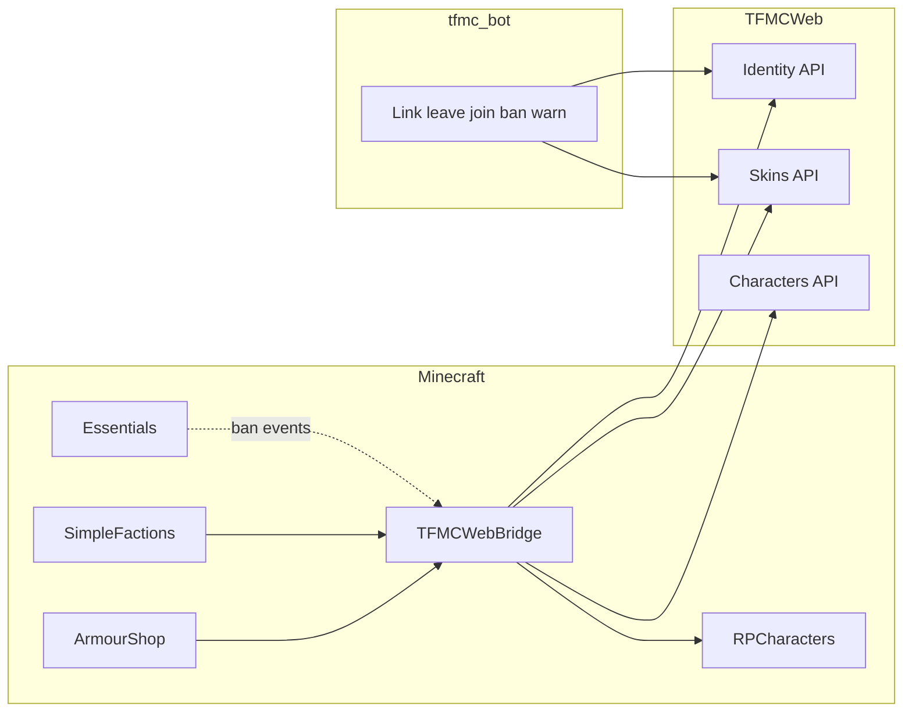

# TFMCWeb (identity, tokens, Discord gate)

**Status:** Implemented.

**Repos:** `tfmcweb/` (Bukkit plugin; depends on TLibs, soft-depends on Essentials) · `TFMCWeb` · `tfmc_bot` · consumers `rpcharacters`, `armourshop`, `drinkbuilder` (depend) and `simplefactions` (soft-depend)

Companion: [integrations/discord-bot.md](../integrations/discord-bot.md) · [integrations/patreon.md](../integrations/patreon.md) · [cosmetics/skins.md](../cosmetics/skins.md)

## Why

**TFMCWeb** is the single TFMC-specific gate to TFMCWeb (like **TFMCCore** is TFMC-specific gameplay; **TLibs** stays portable). It owns identity + tokens; ArmourShop keeps pack apply; SimpleFactions has its own HTTP for map; character creation uses the same identity + scoped codes.

## Locked decisions

| Decision | Choice |
|----------|--------|
| Plugin name | **TFMCWeb** (`net.tfminecraft.tfmcweb`) |
| Owns | HTTP client, plugin key, Discord **link**, scoped **tokens**, link **cache**, Discord **gate** (via RPCharacters freeze), ban/warn **mirrors**, admin `/web` |
| Does **not** own | Pack writing (ArmourShop/DrinkBuilder), map regen (SimpleFactions), character data (RPCharacters), Essentials ban execution |
| Discord required | Every player must link Discord **and** be in the TFMC guild to play Survival |
| Staff / helpers | Discord gate applies **only in Survival** |
| Alts | **None** - one Discord ↔ one Minecraft UUID |
| Leave Discord | **1 hour grace** - rejoin within 1h stays linked; after grace → unlink + freeze |
| Freeze | **RPCharacters** freeze reason `DISCORD_REQUIRED`; do not touch characters |
| Bans | Essentials `/tempban` / `/ban`; TFMCWeb mirrors to Discord bot |
| Warnings | `/warning` (TFMCWeb) → player chat + web store + bot DM |
| Patreon linking and status | `/patreon` (TFMCWeb) starts a link for an unlinked player, displays status, and `/patreon unlink` disconnects the link; backend-owned entitlement and rank application are documented in [Patreon integration](../integrations/patreon.md) |

## Ownership matrix

| Concern | Owner |
|---------|--------|
| Base URL, `X-Plugin-Key`, async HTTP | TFMCWeb (`ProvinceSystemGateway`) |
| UUID ↔ Discord link + guild membership + grace | TFMCWeb identity + TFMCWeb cache + bot leave/join |
| Scoped feature codes (`skin`, `drink`, `profile`, `skin_staff`) | TFMCWeb + TFMCWeb `/token create <scope>` |
| Survival Discord gate freeze | TFMCWeb → RPCharacters API |
| Skin pack apply | ArmourShop (HTTP via TFMCWeb gateway) |
| Drink pack apply | DrinkBuilder (HTTP via TFMCWeb gateway) |
| Character ingest / roster | RPCharacters (HTTP via TFMCWeb gateway) |
| Essentials ban/unban | Essentials executes; TFMCWeb mirrors |
| Discord DMs / banned role / leave events | `tfmc_bot` |
| Patreon LuckPerms groups | TFMCWeb rank writer on exactly one configured server; [Patreon integration](../integrations/patreon.md) |

Domain plugins **depend on TFMCWeb** for network/identity. They do not open raw HTTP to TFMCWeb.

## Architecture



## Identity

Link tables live in the site PostgreSQL database (`discord_links`, `discord_link_codes`) and routes under `/skins/discord/…`.

| Route | Auth | Role |
|-------|------|------|
| `POST /skins/discord/link/start` | Plugin | Issue link code |
| `POST /skins/discord/link/complete` | Staff (bot) | Bind Discord id; reject if Discord already on another UUID |
| `GET /skins/discord/identity/{discord_user_id}` | Staff (bot) | Resolve selected Discord account to UUID and latest known Minecraft name for moderation |
| `POST /skins/discord/link/unlink` | Plugin | Explicit unlink |
| Guild leave/join | Staff (bot) | 1h grace on leave; clear on rejoin |

## War declare codes

One-time codes that gate an in-game war declaration or coalition offensive. Staff mint one in Discord (`tfmc_bot` `factions` cog, `/warcode`) and the leader types it in SimpleFactions. Rows live in `war_declaration_codes`, realm-scoped, hashed with **no plaintext column**: staff see the code once and a lost code is revoked and reminted.

Each code has a `kind`:

| `kind` | `attacker_faction_id` | `defender_faction_id` | `goal` |
|--------|-----------------------|-----------------------|--------|
| `war_declare` (default) | Attacking faction | Defending faction | Optional; the leader picks goals in game. Codes minted before 0005 may still carry one |
| `coalition_offensive` | Coalition leader faction | Coalition target faction | Always `null`; refused at mint |

| Route | Auth | Role |
|-------|------|------|
| `POST /wars/declare-codes` | Staff (bot) | Mint; body `attacker_faction_id`, `defender_faction_id`, optional `kind`, `goal`, `realm_id`, `created_by_discord_id`, `ttl_hours`. Returns `{id, code, realm_id, attacker_faction_id, defender_faction_id, kind, goal, expires_at}` once |
| `POST /wars/declare-codes/validate` | Plugin | Non-consuming; body `code`, `attacker_faction_id`, `defender_faction_id`, optional `kind`, `realm_id`. Returns `{valid, id, kind, goal, realm_id, attacker_faction_id, defender_faction_id, expires_at}` |
| `POST /wars/declare-codes/redeem` | Plugin | Consuming; body as validate plus optional `war_id`. Sets `redeemed_at` and `redeemed_war_id`; returns `{ok, id, kind, goal, realm_id, redeemed_at, war_id}` |
| `GET /wars/declare-codes` | Staff (bot) | Outstanding codes with `kind` and `goal`; ids and metadata, never a code |
| `POST /wars/declare-codes/revoke` | Staff (bot) | Revoke by id |
| `GET /wars/declare-codes/goals` | Staff (bot) | The eight declarable goals. Kept for older bots; the bot no longer pins a goal |

Rules:

- Validate and redeem are separate calls because `WarManager.declareWar` can still refuse after the code was accepted. Redemption happens only once a war (or offensive) exists, so a rejection does not burn a staff-approved ticket.
- `kind` on validate and redeem defaults to `war_declare`, so a request that omits it keeps its old meaning. A code of the other kind is refused with HTTP 400 and `That code is a coalition code, not a war declaration code.` or `That code is a war declaration code, not a coalition code.` This is checked after the realm and before the faction pairing, and does not spend the code.
- Both re-check attacker, defender and realm against the row, so a code minted for one pairing cannot be spent on another.
- `war_id` on redeem is optional; a coalition offensive may not have one.
- **Goal allowlist** (when a `war_declare` code is given a goal): eight of the thirteen `WarGoalType` values. `overthrow`, `change_law`, `change_tax` and `force_peace` are raised by a political movement, never declared, and are refused at mint, as is the retired `war`.
- `goal` is `null` in responses when the code has none. Plugin builds from before kinds expect a goal and will reject such a code.
- `realm_id` on the two plugin routes is injected by **TFMCWeb**, not sent by SimpleFactions, which does not know its own realm.
- TTL from `WAR_CODE_TTL_HOURS` (default 48, mint may override up to 720).

## Tokens

| Command | Scope | Redeems on |
|---------|--------|------------|
| `/token create skin` | `skin` | Profile sign-in or the Skins tab's Use a code |
| `/token create drink` | `drink` | Profile sign-in or the Drinks tab's Use a code |
| `/token create profile` | `profile` | Profile sign-in |
| `/token create skin staff` | `skin_staff` | As `skin` (auto-approve) |

TFMCWeb's drink code message names the website's `/drinks` page, which redirects to Profile's Drinks tab.

Rules:

- Must be Discord-linked and not past grace (Survival players).
- Codes bound to UUID.
- Session TTL: **8h** after redeem.
- Codes consumed on submit (skin/drink) or redeem (profile).
- **Shared mint cooldown (`skin` + `drink`):** owned by **TFMCWeb** only. Profile is not in the shared family.
- **Command gate:** LP `tfmcweb.token.create`; staff perm `tfmcweb.token.create.staff`.
- Skin and drink **upload** entitlements: TFMCWeb `player-meta.*` → `PUT /characters/plugin/rpc-player-meta`, stored per realm in `web_entitlements`. That row is the website's only source for a player's character limit, name colours and wardrobe slots. A player TFMCWeb has never synced gets the creation catalogue's default character limit.
- TFMCWeb sends player meta on join, on config reload and with `/web syncmeta [player]`. About a second after LuckPerms recalculates an online player's permissions, or a group's (which checks every online player), it sends again, so a rank granted while they play (Patreon, staff panel or `/lp`) reaches the website without a rejoin. These LuckPerms-triggered sends skip a player whose meta has not changed since the last send, because LuckPerms recalculates every online player and group on each `sync-minutes` storage sync. Sends for one player are attempted one at a time, newest meta last. A timed-out send can still be applied by the website after a newer one, so after a failed send TFMCWeb resends that player's meta at every recalculation until one succeeds at least 10 minutes after the last failure. This repair is best effort and relies on recalculations happening, which the periodic sync provides. After restoring the website database, run `/web syncmeta` on each server: TFMCWeb cannot see the restore and would otherwise skip online players whose meta has not changed until they rejoin.

## Discord gate + RPCharacters freeze

1. Player in **Survival** and (not linked **or** grace expired after leave) → **freeze**.
2. Linked + in guild (or within 1h grace) → clear Discord freeze reason.
3. **Do not** change active character or delete characters.
4. Non-Survival → **no Discord gate**.

TFMCWeb on join / notice / grace tick: set or clear gate → `reevaluateFreeze(player)`.

## Bans and warnings

- **Bans:** Essentials executes; TFMCWeb enqueues moderation outbox → bot DM + **Banned** role; unban clears role.
- **Warnings:** `/warning <player> <reason>` → in-game chat + web store + bot DM.

Bot does **not** execute MC bans.

## Commands (TFMCWeb)

### Player

| Command | Action |
|---------|--------|
| `/linkdiscord` | Issue link code |
| `/unlinkdiscord` | Explicit unlink |
| `/token create skin\|drink\|profile` | Scoped code |
| `/token resetcooldowns <player>` | Clear shared skin+drink mint cooldown |
| `/patreon` | Show Patreon status; if unlinked, start account authorization |
| `/patreon unlink` | Unlink the Patreon account |

### Staff

| Command | Action |
|---------|--------|
| `/web status` | API reachability, link cache stats |
| `/web reload` | Reload config |
| `/web lookup <player>` | UUID ↔ Discord / grace |
| `/web unlink <player>` | Force unlink |
| `/warning <player> <reason>` | Warn + mirror |

### Patreon rank writer

TFMCWeb reads the `patreon:` block in `config.yml`:

```yaml
patreon:
  enabled: false
  apply-ranks: false
  poll-seconds: 60
  reconcile-minutes: 30
  groups:
    noble: noble
    gilded: gilded
    ascended: ascended
```

Set `apply-ranks: true` on exactly one server because LuckPerms storage is shared. Other servers keep it false. `/patreon` remains available wherever `enabled` is true. See [the Patreon integration guide](../integrations/patreon.md) for operations.

## Realm gateway

Per-realm HTTP gateway, `web_entitlements` sync, realm-scoped token policy, and scoped data queues are **shipped**. Map staff permission `tfmc.map.staff` arrives via player meta for staff map and editor gates.

### Site-wide snapshots are owned by the primary server

The creation catalog, kit skins, masked template, ArmourShop catalog, DrinkBuilder catalog and drink assets are stored **once for the whole site**, and their push routes carry no `realm_id`. Every server pushes them on start; a dev or tutorial restart must not replace the live copy.

Non-primary servers therefore use their own key: list it in `PLUGIN_KEYS_SECONDARY` (comma-separated, `backend/.env`) and set it as `api.plugin-key` in that server's TFMCWeb config. A secondary key works on every plugin route, but pushes to the routes above answer `200` with `"ignored": true` and store nothing. Only the `PLUGIN_KEY` server decides what the website shows.

## Success criteria

- Survival player without Discord link (or past leave grace) is frozen via RPCharacters; characters untouched.
- Staff in non-Survival are not Discord-gated.
- Leave Discord → 1h grace → rejoin OK; after 1h → freeze.
- No alts (one Discord ↔ one UUID).
- `/token create skin`, `drink`, and `profile` work from TFMCWeb.
- Shared skin↔drink mint cooldown enforced on TFMCWeb.
- `/tempban` mirrors to Discord; `/warning` hits chat + Discord.

Staging verify: [STAGING.md](../../STAGING.md).
